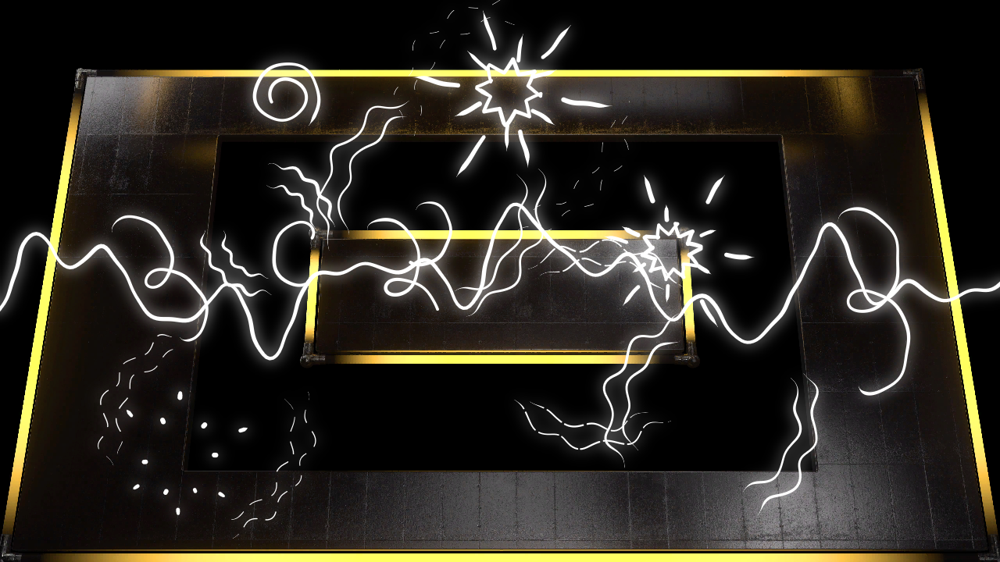
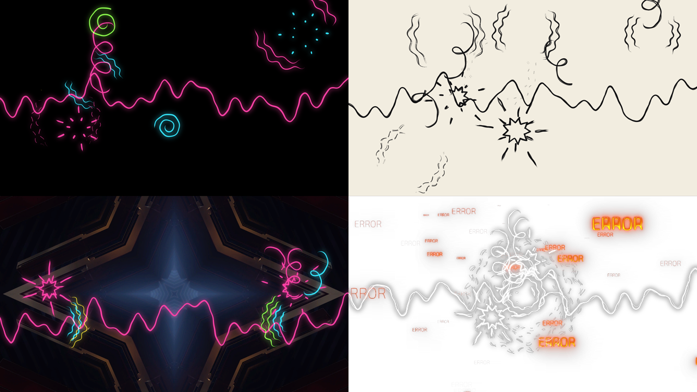

# scrawl

> **AI-assisted project.** This codebase was created with [Claude](https://claude.com/claude-code)
> (Anthropic), directed and reviewed by a human author. It has **never been loaded into
> Resolume**. Everything below is measured by an offline harness that drives the real
> plugin classes in a headless GL context: a held drawing is the same picture to the bit
> until the next one is due, the boil read back out of the rendered pixels matches the
> hand's stated law to 2-3%, a line's cross-section sums to Line Width to a few thousandths
> of a pixel, and a kick is on the page in the first drawing made after it. On Resolume's
> own drum loops (through a stand-in for its FFT, see [Status](#status)) every band's
> onsets fall on the loops' sixteenth notes far beyond chance. The checks are re-run
> against fourteen models that are wrong on purpose and have to fail, eight one-character
> mutants of the shipped shaders and C++ have to be caught, and a control sweep fails if any
> parameter does nothing.

Hand-drawn doodles to the music, for Resolume Arena/Avenue, as two FFGL plugins: **SW
Scrawl**, a source, and **SW Scrawl Over**, the same over your clip. Rings of sound coming
off the speakers, impact stars on the snare, a zigzag bolt on the big kicks, little curls
floating up off the hi-hats, and one long wobbly line that is the music itself. They're
redrawn twelve times a second by a hand that can't hold still, so every line boils.

It's after the sound effects in Edgar Wright's *Scott Pilgrim vs. the World* (2010), where
a basement band's noise gets drawn into the air in felt tip. The plugin borrows the idea
and none of the film's artwork, and it has nothing to do with the film's makers.

SW Scrawl Over at its defaults on Resolume's own NeonRoom2 clip, with its Beat 001
loop driving it, 1.5 s in. Rendered by the plugin's offline harness (`sctest --over --pipe
--wav`), not captured from Resolume.

## The one idea

**Every drawing is a new pass of a hand that can't hold still.** Effects animation is
drawn again for every drawing, twelve a second on twos, and no two passes of a pen land in
the same place. So each doodle has an intended path, a ring or a spike or a zigzag, and
each drawing of it gets its own error from the hand:

- **the boil**, a wobble along the line's normal: three sinusoids in arc length whose
  wavelengths belong to the doodle (a hand has a character) and whose phases belong to
  the drawing;
- **registration**, the whole pass landing a little off and a little twisted, as when a
  sheet isn't quite back on the pegs;
- **pressure**, the pen landing at the start of a stroke, lifting off the end, and pressing
  unevenly in between.

The error scales with the gesture, A = Wobble × (0.003 + 0.02 × extent) frame heights, so
a big circle wanders further than a small tick. Between drawings everything holds still,
the picture included. That's the whole look, and the rest falls out of it:

- **The line boils** at 24, 12 or 8 drawings a second, and nothing moves in between, which
  is what makes hand-drawn animation look hand-drawn.
- **Circles don't close.** A hand-drawn ring runs on past where it started, a little wide of
  it.
- **Strokes taper** where the pen lands and lifts, and a stroke being written on stops
  abruptly at the pen.
- **Wobble 0 is a plotter**: no boil, no registration error, an even width, the same
  picture every drawing.
- **Passes** draws everything two or three times with independent errors, for the sketchy
  doubled line.

The GPU decides nothing. The hand makes every line on the CPU as a chain of capsules; the
shaders rasterise their union, blur a quarter-size copy for the glow, and lay it over the
clip.

## The doodles

| doodle | what sets it off | what it does |
| --- | --- | --- |
| Rings | the kick (the low band) | 1-3 wavy lines spreading out from where the sound came from: arcs either side of it, `(( ))`, when scattered; arcs facing the room from the Speakers; full circles that never quite close from the Centre. They thin out and break into dashes as they go. |
| Bursts | the snare (the middle band) | spikes shooting out from an impact and shrinking to their tips; on a hard hit, a jagged star round it as well |
| Bolts | a kick as hard as the hardest lately | a zigzag with a fork, written in one drawing, flickering on alternate drawings in its second half, then gone |
| Curls | the hi-hats (the high band) | a loop-the-loop or a spiral, written on, drifting off, and wiped from the tail |
| Wave | always, while there's sound | a line across the frame whose wiggle is the spectrum: six sines, the bass a slow swell and the top a fast fizz |

Doodles are born on the frame their hit arrives and appear in the next drawing, which on
twos is never more than a twelfth of a second later. A drawing shows each doodle as it is
half-way through its exposure, so a hit on a drawing's own frame is already on the page.

## What drives it

**Drive** picks what makes the doodles happen. *Audio* listens to Resolume's audio input,
the 64-bin spectrum it gives every FFGL plugin, and runs three onset detectors on it, one
per band, so a kick fires the rings and a hi-hat the curls even when the kick is ten times
louder. Each detector is bassalt's (spectral flux against its own running mean), primed on
its first frame so it isn't deaf for a second and a half after a clip is triggered. *Beat*
ignores the audio and follows Resolume's tempo: rings on every beat, a burst on two and
four, a bolt on the one and curls on the "and"s. *Auto*, the default, follows the music
when there is any and the beat when there isn't, so it does something the moment you drop
it on a layer.

**Hit** fires one of everything at full strength, for a pad on a controller.

## Controls

- **Draw:** Drive (*Auto*, *Audio*, *Beat*). Hit. Drawings (*On Ones*, *On Twos* or *On
  Threes*: 24, 12 or 8 new drawings a second). Wobble (how unsteady the hand is; 0 is a
  plotter). Line Width (0.0015 to 0.02 of the frame's height; the default 0.0065 is 7 px
  at 1080p). Passes (1 to 3). Size (0.5x to 2x every doodle). Linger (0.5x to 2x every
  lifetime). Seed.
- **Doodles:** Rings, Bursts, Bolts, Curls and Wave, how much of each; 0 is none. Rings
  sets 1-3 lines a set; Bursts sets 8-14 spikes, and the star appears from 0.5 on a hard
  hit; Bolts lowers the bar for a bolt and the gap between them (one every 2 s at the
  bottom, every 0.4 s at the top) and adds the fork from 0.5; Curls draws two a hat from
  0.67; Wave sets the line's height.
- **Place:** Placement (*Scatter* anywhere, round the *Centre*, or from two *Speakers*
  either side and low). Centre X and Centre Y.
- **Look:** Palette (*White*, *Ink*, *Neon* or the one *Colour*). Colour. Glow. Backdrop
  (*None*, *Black* or *Paper*; on the effect it goes under the clip, so it shows where the
  clip is transparent).
- **Audio:** Audio (Resolume's FFT buffer). Sensitivity (how quiet a note can be and still
  count). Bass Bins (how many of the lowest bins are the kick's band, 1 to 8). Treble From
  (where the hi-hats' band starts, 4 to 48).
- **Over:** Mix.

Palette Neon on Backdrop Black (the source); Ink on Paper with two passes; Placement
Speakers over Resolume's IntoTheGlow clip; three passes at Wobble 0.9 round the Centre over
its Cyberspace clip. Each with one of Resolume's AV loops driving it. Rendered by `sctest`.

## Status

**v0.1.0, local, 2026-10-13.** Not released, not on GitHub, not registered on the website.

It has **never been loaded into Resolume** on either platform. `oxbow probe` reads both
bundles the way a host does and finds `SW Scrawl` / `SK01` / source and `SW Scrawl Over` /
`SK02` / effect, and `oxbow selftest` renders through them; nothing else has run them.
Only macOS (Apple Silicon) has built or run it. The Windows build exists only as CI
config. The About block is a provisional hand copy with no user guide button (there's no
guide yet), and there's no OpenFX port and no browser demo.

What's measured, on this Mac:

| | |
| --- | --- |
| on twos | over 4 s, the picture changes on **exactly** the frames a new drawing starts on: 96 at On Ones, 48 at On Twos, 32 at On Threes, at 640x360 and 320x180, source and Over, and on no others |
| the boil, from the hand | 400 drawings of a circle at two sizes and two Wobbles: the radial spread between drawings is the law's A²(1/2 + 1/16) to **0.4-1.5%** |
| the boil, from the pixels | one ring held still and drawn 120 times on ones: its radius read back along 282 rays spreads by the law to **2-3%**, at 640x360 and 320x180 |
| the pen | a stroke's ends at zero width and its middle at exactly half Line Width; stopped half-way, it's still pressing; at full Wobble the pressure wanders within ±15% |
| line width | a flat line's every column of coverage sums to Line Width in pixels to **0.0023 px** (half-float coverage), three widths, two rasters |
| latency | a lone kick is on the page in the first drawing made at or after its frame, at 24, 12 and 8 drawings a second, for every frame it can land on |
| the bands | from a cold start mid-song, the kick fires only the low band, the snare only the middle and the hats only the top, each on its own frame; rings, bursts and curls are born on exactly those frames |
| real drums | Resolume's six Beat loops (128 bpm) through the stand-in FFT: each band's onsets are **80-100%** on the sixteenth notes, against 36% by chance (p ≤ 5e-6 for every one of 18) |
| the beat | with no audio, at 100 bpm free-running and at 128 bpm from a host bar phase: every doodle born within a frame of its eighth note |
| silence | Drive Audio draws nothing; Auto falls back to the beat |
| the composite | with nothing drawn, or at Mix 0, the clip comes through **bit-identical**, alpha and all |
| GL state | everything a host could care about, blend equation included (the strokes are drawn with GL_MAX), comes back as it went in |
| second rasteriser | every picture check above passes again on Apple's software renderer |
| negative controls | **14** deliberately wrong models, **all 14** detected |
| mutants | **8** one-character mutants (3 in the GLSL, 5 in the C++), **all 8** caught |
| dead controls | **27** parameters swept, all live: every one but the Audio buffer, the buttons and the About text |

Render cost (`sctest --bench`, busy: every kind at full, a Hit every ten frames, Passes 3,
up to 50,000 capsules a drawing, four runs on a machine shared with other jobs): a new
drawing **2.7-3.5 ms at 720p and 1080p, 4.0-4.2 at 4K**; a held one 0.2-0.5 ms, and
0.9-1.1 at 4K. On twos a new drawing is one frame in five.

What **isn't** verified yet:

- **Resolume's FFT is a guess.** Nobody in the fleet has measured what's in its 64 bins
  (magnitude or power, window, frequency spacing). The real-drum check feeds the loops
  through a stand-in: a 2048-sample Hann window, magnitudes folded into 64 equal bins up to
  Nyquist. If Resolume's bins are spaced differently, Bass Bins and Treble From are how you
  put the bands back on the kick and the hats.
- **The 128 bpm of the loops is inferred**, from their length (7.5 s is four bars at 128).
- **The bass and synth loops are off the grid.** A bass slide never stops rising, so it
  fires the low band all over the place. Fair enough, but it means Rings on a bassline is
  busier than on drums.
- **Resolume's bar phase** is trusted as a downbeat, as across the fleet, unmeasured.
- **The film's lettering isn't here.** No "KRAKOOM" or "RIIING": that needs a typeface and
  its own design, and it's the obvious v0.2.
- **No outline of the subject.** The film draws a crackling aura round its characters; this
  draws in the air, not round anything in the clip.

## Build

It's C++17 + GLSL 4.10, CMake and FFGL 2.1 (the SDK is vendored as a submodule). macOS
builds are universal (arm64 + x86_64); Windows needs GLEW via vcpkg.

    git clone --recursive https://github.com/stoatworks-labs/scrawl
    cmake -B build -DCMAKE_BUILD_TYPE=Release
    cmake --build build
    cmake --install build          # into Resolume's Extra Effects

## Building and testing

The offline harness renders the real plugin classes headlessly:

    ./build/sctest --out /tmp/frame.png                 the source, 100 frames in
    ./build/sctest --over --audio demo --out /tmp/o.png the effect, with a synthetic band
    ./build/sctest --wav "Beat 001.wav" ...             a real WAV through the stand-in FFT
    ./build/sctest --listen --wav "Beat 001.wav"        what the three bands hear
    ./build/sctest --onset            each band fires on its own instrument, from a cold start
    ./build/sctest --bands            rings, bursts and curls born on their hits
    ./build/sctest --music            Resolume's drum loops: onsets on the sixteenths
    ./build/sctest --beat             the beat drive, to the frame
    ./build/sctest --hand             the hand's boil, registration and pressure
    ./build/sctest --twos             new drawings on the boundaries, held between
    ./build/sctest --boil             the boil, out of the pixels
    ./build/sctest --width            a line's cross-section is Line Width
    ./build/sctest --latency          a kick lands in the next drawing
    ./build/sctest --over-check       the clip untouched with nothing drawn, and at Mix 0
    ./build/sctest --resize           a size change mid-show
    ./build/sctest --state            the host's GL state comes back as it went in
    ./build/sctest --negative         every check above, against a wrong model
    tools/mutate.sh                   one character of the shaders and C++, changed
    ./build/sctest --bench            720p through 4K
    python3 tools/sweep.py            no control is silently dead
    tools/verify.sh                   all of it, in under a minute

Filming uses the fleet's frame format and cue sheets:

    ffmpeg -i clip.mov -vf fps=60,format=rgba -f rawvideo - \
      | ./build/sctest --over --pipe --size 1280x720 --wav music.wav \
      | ffmpeg -f rawvideo -pix_fmt rgba -s 1280x720 -r 60 -i - out.mp4

This project is built on other people's work — see [ATTRIBUTIONS.md](ATTRIBUTIONS.md).

## Licence

MIT.

The hand's model is mine: sinusoids in arc length for the boil, a disc for the
registration, minimum-jerk (Flash and Hogan, 1985) for the pen's write-on. The onset
detector is spectral flux with an adaptive threshold, from the literature by way of the
fleet's own macroblock and bassalt. Nothing is copied from the film.
